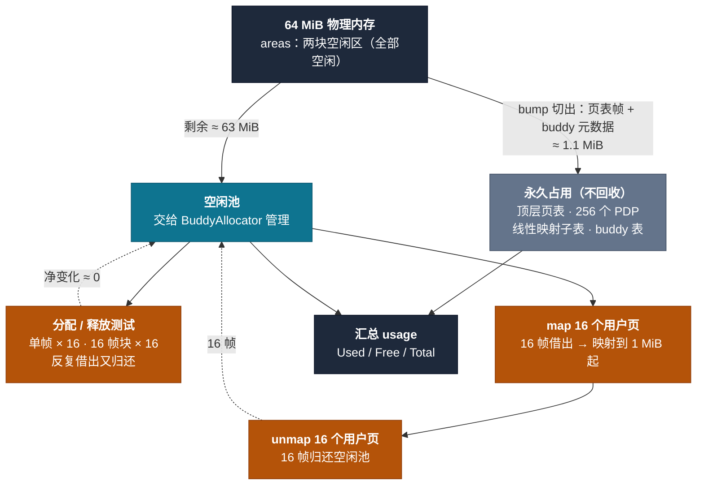

# rmm 源码分析笔记

本文档总结了对 `rmm`（Redox 内存管理 crate）中若干函数的逐行分析与讨论，重点是
`src/arch/emulate.rs` 这套**纯软件模拟 x86_64 页表**的实现，以及 `page/`、
`allocator/frame/` 里与之相关的辅助函数。也涵盖 `page/flags.rs` 的 exec/no-exec
位语义、`page/mapper.rs` 的映射/解映射，以及 `main.rs` 的 `new_tables` 引导流程。

涉及的常量（x86_64 下的实际取值）见 [关键常量](#关键常量)。

---

## 目录

- [EmulateArch::init](#emulatearchinit)
- [Machine::invalidate_all](#machineinvalidate_all)
- [MEMORY_AREAS](#memory_areas)
- [BumpAllocator::new 与 offset](#bumpallocatornew-与-offset)
- [PageMapper::table](#pagemappertable)
- [PageMapper::create](#pagemappercreate)
- [PageMapper::map_phys](#pagemappermap_phys)
- [PageMapper::map_linearly / unmap_phys](#pagemappermap_linearly--unmap_phys)
- [PageFlags::has_execute（exec/no-exec 位语义）](#pageflagshas_executeexecno-exec-位语义)
- [KERNEL_SEPARATE_TABLE（内核独立页表）](#kernel_separate_table内核独立页表)
- [PageMapper::visit](#pagemappervisit)
- [PageTable::index_of](#pagetableindex_of)
- [PageTable::next](#pagetablenext)
- [main.rs::new_tables（引导流程）](#mainrsnew_tables引导流程)
- [跨函数的几个概念](#跨函数的几个概念)
- [代码质量观察（命名问题）](#代码质量观察命名问题)

---

## 关键常量

| 常量 | 值 | 含义 |
|------|-----|------|
| `PAGE_SHIFT` | `12` | 页大小 4096 字节 |
| `PAGE_SIZE` | `4096` (`0x1000`) | 4 KiB |
| `PAGE_ENTRY_SHIFT` | `9` | 每级 512 个条目 |
| `PAGE_ENTRIES` | `512` | 每级页表 512 项 |
| `PAGE_ENTRY_SIZE` | `8` | 每条目 8 字节 |
| `PAGE_ENTRY_MASK` | `0x1FF` | 条目下标掩码（9 位）|
| `PAGE_LEVELS` | `4` | PML4/PDP/PD/PT 四级 |
| `PAGE_ADDRESS_MASK` | `0x0000_FFFF_FFFF_F000` | 保留 bit 12–47（页号）|
| `ENTRY_ADDRESS_SHIFT` | `12` | 条目里地址字段起始位 |
| `ENTRY_ADDRESS_WIDTH` | `40` | 条目地址字段位宽 |
| `ENTRY_ADDRESS_MASK` | `0xFF_FFFF_FFFF` | 40 位地址字段掩码 |
| `ENTRY_FLAGS_MASK` | `0xFFF0_0000_0000_0FFF` | 标志位 = bit 0–11 与 bit 52–63 |
| `ENTRY_FLAG_PRESENT` | `1 << 0` | Present 位 |
| `ENTRY_FLAG_READWRITE` | `1 << 1` | 可写位 |
| `PHYS_OFFSET` | `0xFFFF_8000_0000_0000` | 内核高半区偏移（PML4 slot 256）|

---

## EmulateArch::init

`src/arch/emulate.rs` 第 14–52 行。

**职责**：在模拟的 64 MiB 内存里手工搭一张最小四级页表（做「偏移恒等映射」），
把模拟机存进全局 `MACHINE`，并返回可用的内存区域表。

### 步骤

1. **建模拟机**（第 17 行）

   ```rust
   let mut machine = Machine::new(MEMORY_SIZE);  // 64 MiB
   ```

   `Machine` 内：`memory`（64 MiB 数组充当物理内存）、`map`（软件 TLB）、
   `table_addr`（模拟 CR3）。

2. **手工搭页表**（第 20–43 行）。四张表依次紧挨放在物理地址 0：

   | 变量 | 物理地址 | 角色 |
   |------|---------|------|
   | `pml4` | `0x0000` | 4 级根 |
   | `pdp`  | `0x1000` | 页目录指针表 |
   | `pd`   | `0x2000` | 页目录 |
   | `pt`   | `0x3000` | 页表 |

   `flags = READWRITE | PRESENT = 0b11`。三次连线：

   - `PML4[256] → PDP`：`PHYS_OFFSET` 落在 PML4 index 256（高 9 位 = `0b1_0000_0000`），
     写入 `pml4 + 256*8`。
   - `PDP[0] → PD`、`PD[0] → PT`。
   - `PT[i] → frame i`（i = 0..512）：恒等映射前 2 MiB。

   结果：**虚拟 `PHYS_OFFSET + x` ↔ 物理 `x`（x < 2 MiB）**。

3. **注册并设为当前表**（第 45–48 行）：存入 `MACHINE`，`set_table` 设 `table_addr`
   并触发 `invalidate_all()`（重建软 TLB）。

4. **返回 `&MEMORY_AREAS`**（第 50 行）。

---

## Machine::invalidate_all

`src/arch/emulate.rs` 第 293–345 行。

**职责**：清空软 TLB（`map`），再从当前 `table_addr`（模拟 CR3）出发做一次**完整的
四级页表遍历**，把所有 present 的叶子条目填回 `map`。

真实硬件里这是「TLB miss 时 MMU 按需 walk」，这里被写成每次 `set_table` 都做一次的
**全量 walk**。

### 两个关键式子

- **提取下一级表物理地址**（第 306 行）：

  ```rust
  let a3 = ((e3 >> 12) & A::ENTRY_ADDRESS_MASK) << 12;  // 40 位地址字段
  ```

  条目里地址存的是「物理页号」，位于 bit 12–51（40 位）。`>> 12` 挪到低位、
  `& 0xFF_FFFF_FFFF` 取 40 位、`<< 12` 变回字节地址。等价于 `e3 & 0x000F_FFFF_FFFF_F000`。

- **拼虚拟页号**（第 337 行）：

  ```rust
  let page = (i4 << 39) | (i3 << 30) | (i2 << 21) | (i1 << 12);
  ```

  四个索引对应虚拟地址的四段 9 位位域：bit 39–47 / 30–38 / 21–29 / 12–20。
  **没有做符号扩展**（bit 48–63 恒 0），这是刻意的——与 `translate` 里「只取
  bit 12–47」的查找约定配套（见 [符号扩展与 canonical](#符号扩展与-canonical)）。

### `set_table` 之后紧跟 `invalidate_all` 的语义

`src/arch/emulate.rs` 第 351–354 行：

```rust
fn set_table(&mut self, address: PhysicalAddress) {
    self.table_addr = address;   // 换 CR3
    self.invalidate_all();       // 清空 + 全量重建 map
}
```

等价于真实硬件「`mov cr3` 隐式刷 TLB + 之后按需 miss 填」。

---

## MEMORY_AREAS

`src/arch/emulate.rs` 第 139–149 行。

**职责**：声明这台模拟机器上「可供内核分配」的物理内存区间，作为
`BumpAllocator`/`BuddyAllocator`/`SlabAllocator` 的输入。本身只是静态元数据
（`MemoryArea { base, size }`），不含分配逻辑。

```rust
static MEMORY_AREAS: [MemoryArea; 2] = [
    MemoryArea {
        base: PhysicalAddress::new(4 * PAGE_SIZE),   // 0x4000
        size: 32MiB - 16KiB,                          // 跳过四张页表
    },
    MemoryArea {
        base: PhysicalAddress::new(32MiB),            // 0x200_0000
        size: 32MiB,                                  // 调试用第二块
    },
];
```

两块加起来 64 MiB 减前 16 KiB（被 PML4/PDP/PD/PT 占用，不能再分配）。

---

## BumpAllocator::new 与 offset

`src/allocator/frame/bump.rs` 第 12–44 行。

### `new(areas, offset)` 的逻辑

```rust
pub fn new(mut areas: &'static [MemoryArea], mut offset: usize) -> Self {
    while let Some(first) = areas.first()
        && first.size <= offset          // 第一个 area 整个被 offset 盖过
    {
        offset -= first.size;
        areas = &areas[1..];             // 丢掉这个 area
    }
    Self {
        orig_areas: (areas, offset),     // 存的是「跳过之后」的切片，非原始列表
        cur_areas: (areas, offset),
        _marker: PhantomData,
    }
}
```

`offset` 是「**从传入 areas 起点算起已消耗的字节数**」（绝对握手点）。while 循环把
offset 折算成「第几个 area + 内部偏移」，支持 offset 跨多个 area 的场景。

### `offset()` 方法与 `new` 参数含义不同

```rust
pub fn offset(&self) -> usize {
    (usage().total() - usage().free()) * A::PAGE_SIZE
}
```

`usage().total()` 基于 `orig_areas`（已跳过构造 offset），所以 `offset()` 返回的是
「**本 allocator 自构造以来 `allocate` 掉的增量**」，**不含**构造参数里的 offset。

| | `new(areas, offset)` 参数 | `offset()` 方法 |
|---|---|---|
| 语义 | 绝对握手点（原始 areas 起点算起）| 相对增量（自构造以来）|
| 是否含构造 offset | 是 | **否** |

当前代码未暴露此 bug，因为 `main.rs:183` 唯一一处调用恒传 `0`，两个语义的数值恰好相等。

---

## PageMapper::table

`src/page/mapper.rs` 第 42–46 行。

```rust
pub fn table(&self) -> PageTable<A> {
    unsafe { PageTable::new(VirtualAddress::new(0), self.table_addr, A::PAGE_LEVELS - 1) }
}
```

**职责**：把 mapper 持有的根表物理地址，包装成一个**从整个地址空间起点、最顶层开始
的 `PageTable` 游标**返回，是所有 walk / 查询 / 修改页表的统一入口。

`PageTable`（table.rs 第 5–10 行）是轻量句柄：

- `base: VirtualAddress = 0`：根表覆盖整个虚拟地址空间（`index_of` 用它判范围）；
- `phys = self.table_addr`：根表物理地址（`create()` 分配的新页，或 `current()` 取的
  当前 CR3）；
- `level = PAGE_LEVELS - 1`（x86_64 为 3，即 PML4）。

每次调用**现场构造**一个句柄，`PageTable::new` 是 `unsafe`（信任 `table_addr` 指向合法
页表），信任由 `PageMapper` 的构造不变量保证（SAFETY 注释）。

---

## PageMapper::create

`src/page/mapper.rs` 第 130–167 行。

**职责**：分配一页新内存作为根页表（PML4），并按「表类型 + 架构是否分离内核表」的
规则初始化根表的高半区条目，返回能操作这张新表的 `PageMapper`。它是「从零建一张新
地址空间页表」的入口，与 `current()`（接管当前活跃表）相对。

```rust
impl<A: Arch, F: FrameAllocator> PageMapper<A, F> {
    pub unsafe fn create(table_kind: TableKind, mut allocator: F) -> Option<Self> {
        unsafe {
            let table_addr = allocator.allocate_one()?;      // ① 分配根表页
            let mut table = Self::new(table_kind, table_addr, allocator);

            match (table_kind, A::KERNEL_SEPARATE_TABLE) {   // ② 按两种情况初始化
                (TableKind::Kernel, false) => {
                    // Pre-allocate all kernel top-level page table entries ...
                    for i in A::PAGE_ENTRIES / 2..A::PAGE_ENTRIES {   // i = 256..512
                        let phys = table.allocator.allocate_one().expect("failed to map page table");
                        let flags = A::ENTRY_FLAG_DEFAULT_TABLE;
                        table.table().set_entry(i, PageEntry::new(phys.data(), flags));
                    }
                }
                (TableKind::User, false) => {
                    // Copy higher half (kernel) mappings
                    let active_ktable = PageMapper::current(TableKind::Kernel, ());
                    for i in A::PAGE_ENTRIES / 2..A::PAGE_ENTRIES {
                        if let Some(entry) = active_ktable.table().entry(i) {
                            table.table().set_entry(i, entry);
                        }
                    }
                }
                (_, true) => {
                    // There is a separate page table for the kernel. No need to copy ...
                }
            }

            Some(table)
        }
    }
}
```

### ① 分配根表页

`allocate_one()` 从传入的 `FrameAllocator` 拿**一页**（4 KiB）作为根表，`Self::new`
把地址 + 类型 + 分配器装进 `PageMapper`。新页全 0，是空表，等待第 ② 步决定是否预填
高半区。

### ② 三臂 match：核心逻辑

`match` 两个维度：`table_kind`（建内核表还是用户表）与 `A::KERNEL_SEPARATE_TABLE`
（架构内核是否有独立页表）。x86_64 下 `KERNEL_SEPARATE_TABLE = false`，所以只有前两臂
命中；第三臂 `(_, true)` 给「内核有独立表」的架构（见
[KERNEL_SEPARATE_TABLE](#kernel_separate_table内核独立页表)）。

**臂 1：建内核表（`Kernel, false`）—— 预分配高半区条目**

PML4 下标 256–511 是内核高半区（`PHYS_OFFSET` 起，bit 47 = 1）。给这 256 个槽位**每个
都预分配一张下一级表（PDP）**，写入 `ENTRY_FLAG_DEFAULT_TABLE`（`PRESENT | READWRITE`）。

**为什么要预分配？** 注释：

> Pre-allocate all kernel top-level page table entries so that when the page table is
> copied, these entries are synced between processes.

内核高半区映射是所有进程共享的。提前铺满 PML4 高 256 项后，`create(User)` 只需复制
这 256 个**条目本身**（值相同、指向同一物理表），即可让用户表看到同一套内核映射——
不必递归复制整棵内核页表树。这是「固定骨架、只拷贝指针」的优化，代价是预分配 256 页
（即使很多槽位暂时用不到）。

**臂 2：建用户表（`User, false`）—— 复制内核高半区**

`PageMapper::current(TableKind::Kernel, ())` 取当前活跃内核表根（`()` 是空分配器占位，
这里只读不分配），把它的 PML4 256–511 项**原样拷进**新用户表。于是用户表共享内核的高
半区 PDP——切换地址空间时内核代码/数据仍在同一物理表下。

第 154 行 `if let Some(entry)` 只拷 present 的项（臂 1 已预分配全部，通常都能拷到）。

**臂 3：`(_, true)` —— 内核有独立表，什么都不做**

架构声明 `KERNEL_SEPARATE_TABLE = true`（内核有自己单独的地址空间页表）时，用户表
不应也不能复制内核映射，直接空表返回。

### `table_kind` 在 `create` 与 `map_phys` 里的不同粒度

`create` 里 `table_kind` 决定**整张表的初始化策略**（预分配 / 复制 / 留空）；
`map_phys` 里用的是 `virt.kind()`（lib.rs 第 80–86 行，`isize < 0` 判内核，即 bit 63
= 1），决定**某个具体虚拟地址**该用什么表标志（map_phys 第 225–229 行的
`ENTRY_FLAG_TABLE_USER`）。一个是「这张表给谁用」，一个是「这个地址属于哪半区」。

---

## PageMapper::map_phys

`src/page/mapper.rs` 第 169–237 行。

**职责**：页表映射的核心函数——把物理地址 `phys` 映射到虚拟地址 `virt`，沿多级页表走
到底，在对应层级写入一个页表项（PTE），返回一个用于 TLB 刷新的 `PageFlush`。

```rust
pub unsafe fn map_phys(
    &mut self,
    virt: VirtualAddress,
    phys: PhysicalAddress,
    flags: PageFlags<A>,
    requested_level: u8,
) -> Option<PageFlush<A>>
```

### 参数

- `virt` / `phys`：要建立的映射；`phys` 是**页对齐的物理地址**。
- `flags`：映射属性（可写 / 可执行 / 用户态 / 全局等）。
- `requested_level`：**在这一级页表做叶子映射**。0 = 4 KiB 页；1 = 2 MiB 大页；
  2 = 1 GiB 巨页。

### 逐段拆解

**① 对齐检查**（第 180–190 行）

```rust
let required_align = A::PAGE_SHIFT + usize::from(requested_level) * A::PAGE_ENTRY_SHIFT;
```

x86_64（`PAGE_SHIFT=12`、`PAGE_ENTRY_SHIFT=9`）下：

| requested_level | required_align | 页面大小 |
|-----------------|----------------|---------|
| 0 | 12 | 4 KiB |
| 1 | 21 | 2 MiB |
| 2 | 30 | 1 GiB |

两个 `assert_eq!((x >> align) << align == x)` 验证 virt / phys 都按该大小对齐——大页的
虚拟、物理地址必须同时对齐到大页边界（硬件要求）。

**② 构造页表项**（第 192–197 行）

`PageEntry::new(phys.data(), flags.data())`（entry.rs 第 13–17 行）把物理地址右移
`PAGE_SHIFT`（页号化）、按 `ENTRY_ADDRESS_MASK` 截断、再左移 `ENTRY_ADDRESS_SHIFT`
放进地址字段，最后与 flags 按位或。

若 `requested_level > 0`，用 `A::entry_flag_large(level)` 取大页标志并置位。x86_64 上
`entry_flag_large(1)` 返回 `1 << 7`（PS 位）；level 2（PDP）被注释掉、level 3（PML4）
返回 `None`——所以只有 2 MiB 大页受支持，1 GiB 当前会 panic。

**③ 逐级向下走页表**（第 199–235 行）

```rust
let mut table = self.table();   // 顶层（level = PAGE_LEVELS - 1）
loop {
    let i = table.index_of(virt)?;   // 当前层应落在第几个槽位
    if table.level() == requested_level {
        table.set_entry(i, entry);   // 到目标层，写入 PTE
        return Some(PageFlush::new(virt));
    }
    // 防御：槽位已是大页叶子却想继续下钻 → panic
    // 下一级缺表 → allocator.allocate_one() 分配子表帧并 set_entry
    table = table.next(i)?;          // 或分配后下沉
}
```

- `index_of`（table.rs 第 66–80 行）按 `level_shift = level * 9 + 12` 右移取索引：
  PML4 层右移 39、PD 层右移 21、PT 层右移 12。
- 中间层缺表时（`table.next(i) == None`），`allocate_one()` 分配一帧，用
  `ENTRY_FLAG_DEFAULT_TABLE`（用户态地址再加 `ENTRY_FLAG_TABLE_USER`）写入中间 PTE，
  再继续。

### 失败与遗留

`?` 传播：虚拟地址不在覆盖范围（`index_of` 返回 `None`）、分配器无内存
（`allocate_one` 返回 `None`）→ 整函数返回 `None`。TODO：第 203 行未检查覆盖已存在映射
（重复映射会静默覆盖旧 PTE）；第 223 行子表默认 flags 可能不完全正确。

---

## PageMapper::map_linearly / unmap_phys

### map_linearly（第 239–250 行）

```rust
let virt = A::phys_to_virt(phys);
self.map_phys(virt, phys, flags, requested_level).map(|flush| (virt, flush))
```

`map_phys` 的薄封装：**不需要调用方给虚拟地址**，自己用 `phys_to_virt` 算出物理地址
对应的线性映射地址。`phys_to_virt`（arch/mod.rs 第 94–105 行）就是 `phys + PHYS_OFFSET`
（带溢出检查）；x86_64 的 `PHYS_OFFSET = PAGE_NEGATIVE_MASK + (PAGE_ADDRESS_SIZE >> 1)`
让整块物理内存落在内核高半区（PML4 槽 256 起）。返回 `(virt, flush)`，把算出的虚拟地址
一起交回调用方。

### unmap_phys（第 252–266 行）

`map_phys` 的逆操作：删除 `virt` 的映射，返回 `(物理地址, 层级, 原 flags, PageFlush)`。

```rust
let unmap_parents = A::KERNEL_SEPARATE_TABLE || table.index_of(virt)? < A::PAGE_ENTRIES / 2;
unmap_phys_inner(virt, &mut table, unmap_parents, &mut self.allocator)
    .map(|(pa, lvl, pf)| (pa, lvl, pf, PageFlush::new(virt)))
```

`unmap_parents` 决定「删除后是否递归释放变空的父级页表」：

- `index_of < PAGE_ENTRIES/2`：地址在**低半区 = 用户态**（x86_64 的 PML4 槽 0–255）；
- `KERNEL_SEPARATE_TABLE`：aarch64 等内核独立表时，内核映射也可安全回收。

语义：**用户映射允许回收空页表；内核共享映射（高半区、非独立表）不回收**——对应
`create` 里内核高半区被复制进每张进程表、永不解映射的设计。

递归主体 `unmap_phys_inner`（第 269–314 行）三段：

1. **叶子**（level 0，或带 large 标志的大页）：`set_entry(i, PageEntry::new(0, 0))`
   清空，返回 `(物理地址, 层级, flags)`；
2. **中间层**：`table.next(i)` 递归下钻；
3. **向上回收**：递归返回后，若 `unmap_parents` 且子表现在已空（扫描 512 项无
   present），`allocator.free_one(subtable.phys())` 释放子表帧、清掉父级指向它的条目。

这样删映射的同时回收整条空链路，从底层一路冒泡到顶层。

### 对照

| | `map_linearly` | `unmap_phys` |
|--|----------------|--------------|
| 方向 | 物理 → 线性虚拟（固定偏移）| 虚拟 → 解除映射 |
| 虚拟地址 | 自己算，返回给调用方 | 调用方提供 |
| 页表 | 只分配、不回收 | 只删除、会回收空子表 |
| 返回 | `(virt, flush)` | `(phys, level, flags, flush)` |

两者都靠 `PageFlush` 的 `#[must_use]` 强制调用方处理 TLB：`flush()` 单页失效，
`unsafe ignore()` 显式表示「知道 TLB 可能陈旧」，不处理则编译报错。

---

## PageFlags::has_execute（exec/no-exec 位语义）

`src/page/flags.rs` 第 126–130 行。

```rust
pub fn has_execute(&self) -> bool {
    // Architecture may use no exec or exec, support either
    self.data & (A::ENTRY_FLAG_NO_EXEC | A::ENTRY_FLAG_EXEC) == A::ENTRY_FLAG_EXEC
}
```

要解决的问题：**不同架构对「可执行」用了相反的位表示**。

| 架构 | `ENTRY_FLAG_NO_EXEC` | `ENTRY_FLAG_EXEC` |
|------|---------------------|-------------------|
| x86_64 | `1 << 63`（NX 位）| `0` |
| aarch64 | `0b11 << 53`（XN/UXN 位）| `0` |
| riscv64 | `0` | `1 << 3`（X 位）|

- x86_64 / aarch64：**否定语义**——NX/XN 位 = 1 表示**禁止执行**，= 0 表示可执行。
- riscv64：**肯定语义**——X 位 = 1 表示可执行。

### 表达式如何兼容两种编码

中间 `NO_EXEC | EXEC` 是「所有跟执行权限有关的位」的掩码。关键点：**每个架构上这两个
常量恰好一个非零、另一个恒为 0**，于是表达式退化成正确形式：

- x86_64 / aarch64（`EXEC == 0`）：`data & NO_EXEC == 0` ⟺ NX 位没置位 = 可执行 ✓
- riscv64（`NO_EXEC == 0`）：`data & EXEC == EXEC` ⟺ X 位置位 = 可执行 ✓

setter `execute(value)`（第 119–124 行）对称处理：`custom_flag(NO_EXEC, !value)` +
`custom_flag(EXEC, value)`，两个调用总有一个因 flag 为 0 变成无操作。

### 命名澄清

`NO_EXEC` 位 = 1 是**禁止执行**（no execute），不是「可执行」。这是 CPU 历史设计：
x86_64 早期页表没有执行控制位，后来加 NX/XD 位时为了兼容旧格式，只能新增一个
「禁止执行」位——位不存在/为 0 = 可执行（旧行为），置 1 = 禁止（新能力）。`new()`
默认带上 `ENTRY_FLAG_NO_EXEC`（注释 "no-execute by default"），是 W^X 原则：页默认
不可执行，要执行须显式 `.execute(true)`（即清 NO_EXEC 位）。

### 位运算化简的数学性质

原式把 `(data & m) == m && (data & n) == 0` 压成一个 `data & (m|n) == m`（其中
`m = EXEC`、`n = NO_EXEC`）。前提是 **`m & n == 0`**（两掩码不重叠，本例因一者为 0 而
天然满足）。推导：AND 对 OR 的分配律给出 `(data & m) | (data & n) == m`，重叠前提让
结果里 m 的位只能来自 `data & m`、n 的位必须为 0，两项可独立拆开。集合论视角即
「不相交并集的拆分」。

- 等价的直白写法：`(data & EXEC) == EXEC && (data & NO_EXEC) == 0`，更贴近硬件手册，
  性能相同（编译器折叠恒真项），且不依赖「两个常量恰一个为零」的隐含假设。
- 原式的直觉：`(x & MASK) == EXPECTED` 这一底层惯用法——「在 MASK 选中的位上，x 恰好
  等于 EXPECTED 模式」，`EXEC` 常量同时充当「要匹配的位」和「期望匹配值 0」两个角色。

同套路用于 `has_write()`（第 112–115 行，readonly/readwrite）和 `is_global()`
（第 141–144 行，global/no-global）。

---

## KERNEL_SEPARATE_TABLE（内核独立页表）

`src/arch/mod.rs` 第 24 行的 `Arch` trait 常量。各架构取值：

```
aarch64.rs:9    const KERNEL_SEPARATE_TABLE: bool = true;    ← 唯一 true
x86.rs:10       false
x86_64.rs:9     false
emulate.rs:56   false
riscv64/sv39:12 false
riscv64/sv48:9  false
riscv64/sv57:9  false
```

这个差异不是软件设计选择，而是**硬件结构决定的**。

### 含义

- `false`：内核和用户**共用一张根表**。内核高半区映射被复制/共享进每一张用户表的根。
- `true`：内核有**自己单独的一张根表**，用户进程的根表**不含**内核映射。

### 硬件根源：寄存器结构不同

**x86_64（false）**：只有一个 `CR3`，靠虚拟地址 bit 47 切高低半区，但两半区都从同一
CR3 指向的 PML4 翻译。所以用户表**必须**含内核映射，否则切到用户态后内核代码/数据就
看不见了。做法：每个用户进程的 PML4 高 256 项指向同一套内核页表（`create` 臂 1 预分配
+ 臂 2 复制）。

**AArch64（true）**：有两个寄存器 `TTBR0_EL1`（用户）/ `TTBR1_EL1`（内核）。硬件按地址
高位自动选寄存器翻译。所以内核有自己的专属根表（TTBR1），用户表（TTBR0）天然不含内核
映射；切换用户进程只换 TTBR0，TTBR1 不动。对应 `aarch64.rs` 第 71–97 行
`table`/`set_table` 里的 `ttbr0_el1`/`ttbr1_el1` 两条汇编分支，而 x86_64 的 `table`
忽略 `table_kind` 只读一个 `cr3`。

### 落到 `create` 三臂

| 情况 | 架构 | `create` 该做什么 |
|------|------|------------------|
| `(Kernel, false)` | x86_64 等 | 预分配高半区 256 项，铺好内核表骨架 |
| `(User, false)` | x86_64 等 | 从活跃内核表拷贝高半区 256 项 |
| `(_, true)` | AArch64 | 内核/用户根本是两张表，无需复制，直接空表 |

### 两种模型代价

| | 共享式（x86_64, false）| 分离式（AArch64, true）|
|---|---|---|
| 寄存器 | 一个 CR3 | 两个 TTBR |
| 内核映射在哪 | 复制进每张用户表的根 | 只在内核自己的表里 |
| 切换用户进程 | 换 CR3，高半区不变 | 只换 TTBR0，TTBR1 不动 |
| 代价 | 每张用户表占 256 个根条目；建表时要预分配/复制 | 内核表独立维护，无复制；但内核访问用户内存需显式处理 |

---

## PageMapper::visit

`src/page/mapper.rs` 第 56–80 行。

**职责**：从根表沿某个虚拟地址一路下沉，找到负责该地址的**叶子条目**，把
「`&mut PageTable` + 条目下标」交给闭包 `f` 处理。`translate` 和 `remap*` 都建立在它
之上。

```rust
fn visit<T>(&self, virt: VirtualAddress, f: impl FnOnce(&mut PageTable<A>, usize) -> T)
    -> Option<T>
{
    let mut table = self.table();
    loop {
        let i = table.index_of(virt)?;
        match (NonZeroU8::new(table.level().try_into().unwrap()), unsafe { table.entry(i) }) {
            (None, _) => return Some(f(&mut table, i)),                 // level 0（PT），必是叶子
            (Some(level), Some(entry))
                if A::entry_flag_large(level).is_some_and(|f| f & entry.data() != 0) =>
            {
                return Some(f(&mut table, i))                          // 大页（2 MiB）也是叶子
            }
            _ => table = unsafe { table.next(i)? },                    // 中间层，下沉
        }
    }
}
```

### 判断「叶子」的三条规则

1. **level 0（PT）**：`NonZeroU8::new(0) == None` → 无论条目如何都是叶子。
2. **大页**：条目存在且带 large 标志（x86_64 的 `1<<7`，仅 PD 层支持）→ 叶子。
   `entry_flag_large(level)` 只在支持大页的层级返回掩码，其余返回 `None`。
3. **中间层**：其余情况 `table.next(i)` 下沉。

### 返回值

- 中途 `index_of` / `next` 失败 → `None`；
- 到叶子，`f` 返回 `T` → `Some(T)`。

`translate`（第 82–85 行）用 `??`：外层 `?` 是「是否走到叶子」，内层 `?` 是闭包返回的
`Option<PageEntry>`。

### 与 `map_phys` 手写循环的区别

`map_phys`（第 200–235 行）没用 `visit`，因为下沉途中遇到缺表要**当场分配并
`set_entry`**，需要 `&mut self` 拿 allocator；`visit` 是 `&self` 只读走，到叶子才把
`&mut table` 交给闭包。

---

## PageTable::index_of

`src/page/table.rs` 第 66–80 行。

```rust
pub(super) fn index_of(&self, address: VirtualAddress) -> Option<usize> {
    let address = VirtualAddress::new(address.data() & A::PAGE_ADDRESS_MASK);  // ①
    let level_shift = self.level * A::PAGE_ENTRY_SHIFT + A::PAGE_SHIFT;        // ②
    let level_mask = A::PAGE_ENTRIES.wrapping_shl(level_shift as u32).wrapping_sub(1);  // ③
    if address >= self.base && address <= self.base.add(level_mask) {          // ③ 范围校验
        Some((address.data() >> level_shift) & A::PAGE_ENTRY_MASK)             // ④
    } else {
        None
    }
}
```

**职责**：求某虚拟地址在当前层级对应第几个条目（0–511），并校验地址是否归本表管。

### ① 掩码（注释里的 "canonicalize"）

`& PAGE_ADDRESS_MASK`（`0xFFFF_FFFF_F000`）保留 bit 12–47，丢页内偏移与高位。措辞不
严谨——做的不是符号扩展检查，而是「只留页号位」。

### ② `level_shift = level * 9 + 12`

每级 9 位索引在虚拟地址里的位置：

| level | 表 | level_shift | 索引位 |
|-------|-----|-------------|--------|
| 3 | PML4 | 39 | bit 39–47 |
| 2 | PDP  | 30 | bit 30–38 |
| 1 | PD   | 21 | bit 21–29 |
| 0 | PT   | 12 | bit 12–20 |

### ③ `level_mask` 与范围校验

`512 << level_shift` 是本级一张表的覆盖字节数（PML4 覆盖 2^48，PDP 2^39，PD 2^30，
PT 2^21），减 1 得区间末端偏移。`base ≤ address ≤ base + level_mask` 校验地址归本表管。

### ④ 提取下标

```rust
(address.data() >> level_shift) & A::PAGE_ENTRY_MASK   // & 0x1FF
```

例：`PHYS_OFFSET` 在 PML4（level 3）→ `(0x8000_0000_0000 >> 39) & 0x1FF = 256`，
命中 PML4[256]；下沉到 PDP（level 2）→ `(0x8000_0000_0000 >> 30) & 0x1FF = 0`。

---

## PageTable::next

`src/page/table.rs` 第 82–94 行。

```rust
pub unsafe fn next(&self, i: usize) -> Option<Self> {
    if self.level == 0 {
        return None;
    }

    unsafe {
        Some(PageTable::new(
            self.entry_base(i)?,
            self.entry(i)?.address().ok()?,
            self.level - 1,
        ))
    }
}
```

**职责**：沿多级页表「向下走一级」——取出本页表第 `i` 项指向的下一级页表，构造并返回
一个描述它的 `PageTable` 游标。这是 `map_phys` / `visit` / `unmap_phys_inner` 逐级下钻
的统一封装。

`PageTable<A>`（table.rs 第 5–10 行）是「某一级页表」的轻量句柄：`base` 是它覆盖的
虚拟地址起点，`phys` 是这一级页表所在的物理地址，`level` 是层级（越深值越小，0 = 叶子
级）。`next(i)` 返回的就是第 `i` 项指向的那张子表的句柄。

### 逐行拆解

1. **`if self.level == 0 { return None; }`** — `level == 0` 是最后一级（叶子级），每一项
   指向的是普通物理页（或大页），不是下一级页表，所以不存在「下一级」，直接 `None`。

2. **`self.entry_base(i)?`** — 第 `i` 项管辖的起始虚拟地址，作为子表的 `base`：

   ```rust
   let level_shift = self.level * A::PAGE_ENTRY_SHIFT + A::PAGE_SHIFT;
   Some(self.base.add(i << level_shift))
   ```

   本级每项覆盖 `2^level_shift` 字节，第 `i` 项覆盖 `[base + i·2^level_shift, base +
   (i+1)·2^level_shift)`。这个下界就是下一级页表的 `base`。

3. **`self.entry(i)?.address().ok()?`** — 读取第 `i` 个 PTE 指向的物理地址：

   - `entry(i)`（第 51–56 行）把 `self.phys` 经 `A::phys_to_virt` 转成虚拟地址，加上
     `i * A::PAGE_ENTRY_SIZE` 读出一个 `usize` 得到 `PageEntry`；
   - `address()`（entry.rs 第 33–44 行）从 PTE 地址字段解码物理地址，**present 才返回
     `Ok`，否则 `Err`**；
   - `.ok()?` 把 `Err` 转成 `None` —— PTE 的 present 位没置位说明子表尚未分配。

   因此 `next` 是**尽力探测**而非断言：`i` 越界（`entry_base`/`entry` 的 `?`）、PTE
   不存在、或 `level == 0`，任何一环都返回 `None` 而不是 panic。

4. **`self.level - 1`** — 子表层级减一。

5. **`PageTable::new(...)`**（第 13–20 行）只做字段打包，`phys` 直接存第 `i` 项的解码
   地址，不额外校验对齐。

### 三个参数与字段的对应

| 字段 | `next` 传入的值 | 含义 |
|------|----------------|------|
| `base` | `entry_base(i)` | 子表覆盖的虚拟地址起点 |
| `phys` | `entry(i).address()` | 子表所在的物理地址 |
| `level` | `level - 1` | 层级减一 |

### 为什么是 `unsafe`

函数内没有越界读写（内存访问都收在 `entry`/`entry_base` 里且做了 `i < PAGE_ENTRIES`
检查）。标 `unsafe` 是语义层面的不变量：调用者必须保证 `i` 指向的确实是一张**有效的下
一级页表**，且返回的 `PageTable` 会被安全地用于后续访问——物理地址到虚拟地址的映射
（`phys_to_virt`）、页表物理页本身的有效性都由调用者承担。

### 在代码库中的用法

`mapper.rs` 第 79 行 `visit` 里 `table = unsafe { table.next(i)? }` 下沉；`map_phys`
第 219–231 行在缺表时先分配子表帧、`set_entry` 后 `table.next(i)?` 下沉；`unmap_phys_inner`
第 291 行同样递归下钻；`main.rs` 第 41 行用它在 `dump_tables` 里做演示遍历。整体把「多
级页表的逐级下钻」封成一条链式 `?`：`entry_base` 管虚拟区间、`entry` 管 PTE 读取、
`address().ok()` 管 present 检查、`level-1` 管层级推进。

---

## main.rs::new_tables（引导流程）

`src/main.rs` 第 172–272 行。

**职责**：在软件模拟架构 `EmulateArch` 上跑通整套内存管理——「bump 分配器 → 建页表 →
切活动表 → buddy 接管 → 映射/解映射自测」，本质是 `rmm` 的集成自测程序，不是内核里的
真实初始化路径。

### 背景：EmulateArch::init 给出的起点

`init()`（emulate.rs 第 14–52 行）造了一台 64 MiB 的 `Machine`（`Box<[u8]>` + 软件
TLB），手工搭了一张硬编码页表 `PML4[256]→PDP→PD→PT`，把**物理 0–2 MiB 恒等映射**到
`PHYS_OFFSET` 起的线性地址，设为活动页表。它返回两个 `MemoryArea`：

```rust
{ base: 4 页, size: 32MiB - 4 页 },   // 跳过被 PML4/PDP/PD/PT 占用的前 16 KiB
{ base: 32MiB, size: 32MiB },          // 调试用第二块
```

### 十二步（执行顺序）

1. **读取 areas**：两块空闲物理内存，共 64 MiB。
2. **统计内存**：求和打印 `Memory: 64 MB`。
3. **建 BumpAllocator**（bump.rs）：顺序切分、只分配不回收，分配时 `write_bytes` 清零帧。
4. **PageMapper::create(Kernel)**：分配顶层页表；x86_64（`KERNEL_SEPARATE_TABLE=false`）
   还会预分配高半区（PML4 槽 256–511）256 个 PDP 帧。
5. **循环 map_linearly**：逐页把物理内存映射到 `PHYS_OFFSET` 线性地址，`write(true)`；
   `flush.ignore()`（注释 "Not the active table"——新表还没切换，不用刷 TLB）。
6. **make_current()**：切活动页表，`set_table` 触发 `invalidate_all()` 全量重建软件 TLB。
7. **bump.offset()**：打印「Permanently used」（建页表永久占用的引导内存）。
8. **BuddyAllocator::new(bump)**：消费 bump 分配器，把剩余内存建成 buddy 空闲块。
9. **分配/释放测试**：16 轮交错 `allocate_one`/`free_one` 与 16 帧块
   `allocate`/`free`，锻炼 buddy 的拆分与合并。
10. **map 16 个用户页**：`PageMapper::current` + 逐页 `map_phys`（`1MiB..1MiB+64KiB`，
    `user(true).write(true)`），`PageFlushAll` 收集后统一 flush。
11. **unmap 16 个用户页**：`unmap_phys` → `free_one` 回收物理帧，批量 flush。
12. **打印 usage**：buddy 的 Used / Free / Total 统计。

### 两处关键交接

- **① 第 4→6 步**：`PageMapper::create` 靠 bump 分配器造页表帧，建好线性映射后
  `make_current()` 才真正接管地址翻译——所以第 5 步能 `flush.ignore()`（表还没激活）。
  引导期隐含前提：建表用的帧落在 bump 区域低端，被 `init()` 那张「物理 0–2 MiB 恒等
  映射」覆盖，`phys_to_virt` 清零新帧才不会越界 panic。
- **② 第 7→8 步**：bump 把「用剩的内存」整体交给 `BuddyAllocator`，此后分配回收全走
  buddy；第 9–12 步是功能自测。

`main()` 在 `new_tables` 之后还会用 `EmulateArch::read/write` 通过线性映射直接读写物理
地址（读一个字节、写 `0x5A`、再读回），验证「虚拟地址 → 页表 → 物理内存」整条链路。

### 为什么需要两个分配器（两阶段）

`new_tables` 先建 `BumpAllocator`（main.rs 第 183 行），建好页表和线性映射后，再把它
**消费**给 `BuddyAllocator::new`（main.rs 第 207 行）接管。这不是风格偏好，而是**鸡生蛋、
蛋生鸡的循环依赖**，必须用「零元数据的 bump」先打破，再切换到「有元数据的 buddy」正式
工作。

**两者能力的对比（看结构体与签名）**

`bump.rs` 的 `BumpAllocator`：

```rust
pub struct BumpAllocator<A> {
    orig_areas: (&'static [MemoryArea], usize),  // 只存「区域切片 + 偏移」
    cur_areas: (&'static [MemoryArea], usize),
}
```

- `allocate` 是纯算数前进：找到一块够大的区域，`cur_areas.1 += req_size`，返回
  `base.add(off)`。**不维护任何内存中的数据结构**，全部状态就在这几个栈字段里；
- `free` 是 `unimplemented!("BumpAllocator::free not implemented")` —— **根本不能释放**。

`buddy.rs` 的 `BuddyAllocator`：

```rust
pub struct BuddyAllocator<A> {
    table_virt: VirtualAddress,   // 它的元数据表存在某个物理帧里
}

pub unsafe fn new(mut bump_allocator: BumpAllocator<A>) -> Option<Self> {
    let table_phys = bump_allocator.allocate_one()?;   // ① 向 bump 要一帧放 buddy 表
    let table_virt = A::phys_to_virt(table_phys);      // ② 依赖线性映射写这张表
    // ③ 用 bump_allocator.offset() 跳过 bump 已发出去的帧，登记剩余空闲内存
}
```

对比：bump 的元数据是**栈上的几个 usize**，自包含、不依赖任何已映射内存；buddy 的元数据
是**一张存在物理内存里的表**，构造它需要两件事——分配一个物理帧放表、经 `phys_to_virt`
写这张表。而这两件事在「页表和线性映射还没建好」时都做不到。

**循环依赖链**

要建正式页表，就得给每张页表分配物理帧（`PageTable` 就是一个放 PTE 的物理页）；分配物理
帧需要一个 `FrameAllocator`。若一开始就用 buddy：

```
构造 BuddyAllocator
  → allocate_one() 拿一帧放 buddy 表
    → buddy 自己就是那个分配器，还没构造完，无法分配        ← 自引用死锁
  → 写表要靠 phys_to_virt
    → phys_to_virt 依赖 PHYS_OFFSET 线性映射已建立
      → 线性映射是页表条目，页表又需要分配物理帧
        → 又回到需要分配器
```

`map_phys`（mapper.rs 第 219–231 行）沿页表下钻遇缺表时也要 `self.allocator.allocate_one()`
分配子表帧——所以**建立映射本身就需要一个能工作的分配器**。bump 能打破这个环，正因为它
不需要元数据：纯前进游标，`allocate` 不读不写被管理的内存，所以能发出最初的页表帧。

**两阶段在代码里的对应**

- **阶段一（bootstrap）**：`BumpAllocator::new(areas, 0)`（第 183 行）→
  `PageMapper::create(Kernel, &mut bump_allocator)`（第 187 行，`create` 内部分配顶表 +
  预分配 256 个 PDP 帧）→ 循环 `map_linearly` 建立线性映射（第 189–196 行）→
  `make_current()`（第 200 行）。这一步之后 `phys_to_virt` 才真正可用——这是 buddy 构造
  的前置条件。
- **阶段二（接管）**：`BuddyAllocator::new(bump_allocator)`（第 207 行）**消费** bump，
  用 `bump_allocator.offset()`（第 204 行）算出 bump 已发出去的字节数，把**剩余**空闲
  内存登记进 buddy 表——bump 阶段一分配出去的所有页表帧被「跳过」，buddy 只管理剩下的，
  不会重复分配。

之后第 209–231 行的 `allocate_one`/`free_one`/`allocate(16)`/`free(16)` 以及第 233 行起
的 `map_phys`/`unmap_phys` + `free_one`，**都需要能释放**——这正是 bump 做不到
（`free` 是 `unimplemented!()`）、buddy 能做的。

**一句话总结**：bump 是 bootstrap 分配器（零元数据、纯推进、不可 free），唯一意义是在页
表和线性映射建立之前先发出建表所需的物理帧；buddy 是正式分配器（能 free、能做伙伴合并），
但它的元数据表自己占一个物理帧、访问它依赖 `phys_to_virt`，所以只能在阶段一完成后踩着
bump 的剩余内存接管。`BuddyAllocator::new(bump_allocator)` 这个「buddy 构造时接受 bump」
的签名，正是两阶段在类型系统上的交接点。

### 内存视角流程图

不以「函数调了谁」为线，而以「内存此刻归谁、还剩多少」为线——被测试对象是内存管理器，
衡量它的量就是内存去向：



颜色表示内存**去向**：深灰 = 汇总/总量，青 = 空闲池，琥珀 = 借出/使用中，灰 = 永久
占用。

- **① 切分**：`PageMapper::create` 造页表 + `BuddyAllocator` 造元数据，这段 ≈ 1.1 MiB
  被 bump 永久切走、不再归还；其余才成为可回收的空闲池，对应 `bump.offset()` 打印的
  "Permanently used"。
- **② 周转**：测试循环与 map/unmap 都是「从空闲池借出、再原样归还」——虚线表示
  「净变化 ≈ 0」。最终 `usage()` 反映的是**永久占用 + 当前还借在外面的帧**。

> 数值为 EmulateArch（x86_64 布局）下的近似；另有 16 KiB 被 `init()` 的初始页表占用、
> 未计入 `areas`。

---

## 跨函数的几个概念

### 虚拟地址的 canonical 规则 vs 物理地址字段

- **虚拟地址**：有 canonical 规则（bit 48–63 必须是 bit 47 的符号扩展），否则 CPU
  报 **#GP（向量 13，error code 0）**，且**不更新 CR2**；由内核 IDT 处理，用户态表现为
  SIGSEGV，内核态表现为 oops/panic。真实实现见 `x86_64.rs::virt_is_valid`（第 66–73 行）。
- **物理地址**：无符号扩展；它写进条目的是定宽 40 位字段（bit 12–51）。它的约束是
  **MAXPHYADDR 上限**，超出位非 0 时报 **#PF（reserved bit 置位）**，不是 #GP。

### 40 位字段 vs 每级 9 位

两者是**不同轴**上的位数，互不矛盾：

- **每级 9 位** = 虚拟地址如何拆开索引页表，决定 48 位虚拟地址空间；
- **40 位字段** = 条目里物理地址的位宽，对应 52 位物理地址空间（4 PB）。

`ENTRY_ADDRESS_MASK = 2^40 − 1 = 0xFF_FFFF_FFFF`。不是 52 位（那会吞 NX/保留位）、
不是 36 位（那只是某些 CPU 的 MAXPHYADDR，小于架构字段宽度）。

### 符号扩展与 `invalidate_all` 的 `page`

`page` 无符号扩展（bit 48–63 恒 0）是**当前实现的简化**，与 `translate` 里
`& PAGE_ADDRESS_MASK` 的查找约定配套；`EmulateArch::virt_is_valid` 恒真，刻意绕开了
canonical 规则。忠实模拟应该保留 canonical 检查、再只用 bit 12–47 walk。

### 按需 vs 全量

`EmulateArch` 目前只服务「init + 读写」，`invalidate`（第 288–290 行）是
`unimplemented!()`，动态 map/unmap 未支持。一旦支持运行中建页表，单条 `invalidate`
应只沿单路径 walk、只更新一个 `map` 条目（O(深度)），而非每次 `set_table` 全量重建。

---

## 代码质量观察（命名问题）

这些名字的共同点是「用一个宽泛/错误的词覆盖一个更具体、甚至相反的行为」：

| 位置 | 问题 | 更准确的名字 |
|------|------|-------------|
| `BumpAllocator::offset()` | 名不副实，与构造参数 `offset` 同名不同义（增量 vs 绝对握手点）| `consumed()` / `used_bytes()` |
| `BumpAllocator::orig_areas` | 存的是跳过 offset 之后的切片，非「原始」| `remaining_areas` / `pool` |
| `PageMapper::table()` | 动词当名词；返回的是根表**游标**，且每次现场 new | `root()` / `cursor()` |
| `Machine::invalidate_all` | 实为「清空 + 全量重建」，名字只提「失效」| `rebuild_map()` / `walk_and_fill()` |
| `index_of` 里注释 "canonicalize" | 实为「只留页号位」，非符号扩展检查 | 注释应改为 "mask to page number" |
| `EmulateArch::virt_is_valid` | 恒 `true`，名字承诺了检查但未检查（留空实现）| — |
